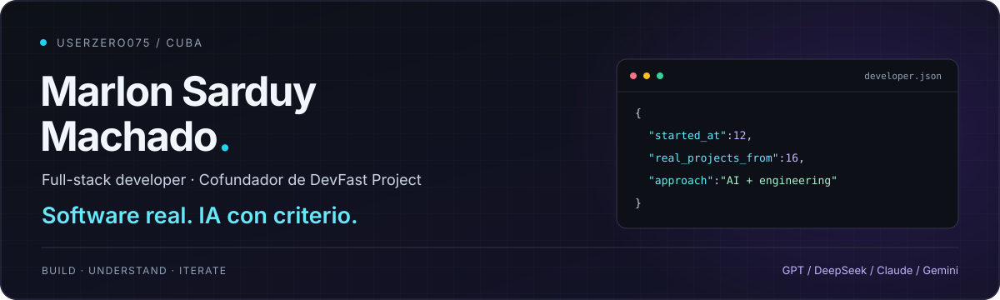
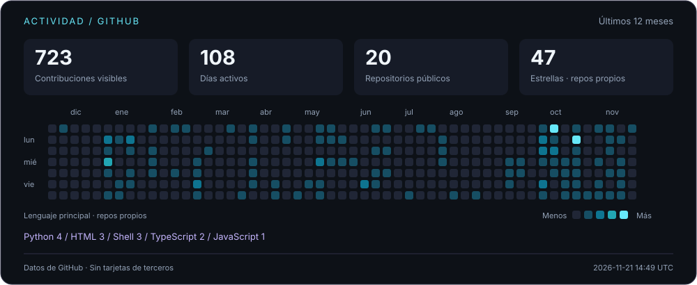

**Full-stack developer · Cofundador de DevFast Project · Cuba 🇨🇺**

[Sobre mí](#01--detrás-del-código) · [Trayectoria](#02--una-base-que-viene-de-antes-de-la-ia) · [IA](#03--ia-con-profundidad-no-solo-prompts) · [Stack](#04--mi-caja-de-herramientas) · [Proyectos](#05--del-problema-al-software) · [Actividad](#06--actividad-en-github)

---

## 01 / Detrás del código

Soy **Marlon Sarduy Machado**, programador autodidacta de **San José de las Lajas, Mayabeque, Cuba**. Construyo bots, APIs, aplicaciones web, herramientas de automatización e infraestructura Linux/VPS: software pensado para resolver necesidades concretas.

Cofundé **DevFast Project** junto a **Yama**. Ahí experimento, desarrollo herramientas, administro infraestructura, ofrezco servicios digitales y convierto problemas de negocios en soluciones que funcionan fuera de una demo.

> **La IA acelera mi trabajo; no sustituye mi criterio técnico.** Mi experiencia empezó antes de los asistentes de código y va mucho más allá de seguir tutoriales o generar una aplicación con un prompt.

## 02 / Una base que viene de antes de la IA

| Etapa | Lo que hay detrás |
| :--- | :--- |
| **12 años · El inicio** | Empecé a aprender programación **sin internet, sin cursos y de forma autodidacta**. La base fue explorar, probar, equivocarme y entender cómo funcionaban las cosas. |
| **14 años · Más recursos** | Empecé a tener acceso a **internet y cursos**, ampliando los conocimientos que ya venía construyendo por mi cuenta. |
| **Desde los 16 · Mundo real** | Comencé a desarrollar para **negocios y proyectos reales**, enfrentándome a necesidades y problemas que no vienen resueltos en un tutorial. |
| **Hoy · 19, casi 20** | Combino esa trayectoria con conocimientos sólidos de **IA aplicada y Machine Learning**, usando nuevas herramientas sin renunciar a los fundamentos. |

**Sí, hoy programo con IA. No, mi experiencia no se reduce al vibe coding.** Puedo aprovechar ese enfoque para explorar y prototipar, pero entender, revisar, depurar y mantener el software sigue siendo parte de mi trabajo como desarrollador.

## 03 / IA con profundidad, no solo prompts

  
  
  
  
  

Tengo **conocimientos sólidos de inteligencia artificial**, tanto en el ecosistema actual de modelos —**GPT, DeepSeek, Claude, Gemini y modelos abiertos**— como en los fundamentos de **Machine Learning**. No veo la IA únicamente como un chat que escribe código.

| Área | Mi enfoque |
| :--- | :--- |
| **Desarrollo asistido por IA** | Vibe coding y prototipado rápido cuando aportan valor, con revisión del código, depuración y decisiones técnicas propias. |
| **RAG · Retrieval-Augmented Generation** | Recuperación de información, embeddings, búsqueda semántica y contexto para conectar modelos con conocimiento relevante. |
| **LLMs e integración** | Uso de modelos mediante APIs, gestión del contexto y automatización de flujos; elegir la herramienta según el problema, no por la marca. |
| **Machine Learning** | Conocimiento de datos, entrenamiento, evaluación y generalización: entender qué aprende un modelo y cómo valorar sus resultados. |

> **No se trata de pedirle a una IA que construya algo. Se trata de saber qué construir, por qué y cómo comprobar que funciona.**

## 04 / Mi caja de herramientas

  

| Capa | Tecnologías |
| :--- | :--- |
| **Lenguajes** | TypeScript · JavaScript · Python · Go |
| **Backend y APIs** | Node.js · FastAPI · Flask · Django · Telegram Bot API |
| **Web y móvil** | React · React Native · Tailwind CSS |
| **Datos** | PostgreSQL · SQLite · Prisma |
| **Infraestructura** | Linux · VPS · Docker · Automatización |

## 05 / Del problema al software

Una selección de productos, herramientas y repositorios en los que trabajo. **Los forks se indican como tales.**

| Proyecto | Qué resuelve | Enfoque |
| :--- | :--- | :--- |
| **[DevFast Manager](https://github.com/UserZero075/Business-Management-Dashboard)** | Gestión empresarial para pymes digitales: proyectos, infraestructura, finanzas, equipo y tareas. | `Full-stack` `Negocios` |
| **[ZerogramJS](https://github.com/UserZero075/ZerogramJS)** | Librería Node.js para crear bots de Telegram, con sesiones, comandos y middleware. | `TypeScript` `Bots` |
| **[WebConsole](https://github.com/UserZero075/webconsole)** | Terminal web sobre Tailscale, con PTY real y xterm.js. | `Linux` `Infraestructura` |
| **DF VPN Downloader** | Servicio de descarga para Cuba: bot + servidor + APK Android. | `Servicios` `Android` |
| **[JsonFlux](https://github.com/UserZero075/JsonFlux)** ↗ fork | Almacenamiento y flujo de datos JSON en un servidor propio. | `Datos` `Self-hosted` |
| **[SpawnSpace](https://github.com/UserZero075/SpawnSpace)** | Script Linux para expandir almacenamiento mediante LVM. | `Shell` `Linux` |
| **[FileStreamBot](https://github.com/UserZero075/FileStreamBot)** ↗ fork | Bot de Telegram para generar enlaces directos de descarga. | `Telegram` `Descargas` |

  <a href="https://github.com/UserZero075?tab=repositories"><b>Ver todos los repositorios →</b></a>

## 06 / Actividad en GitHub

Panel generado desde GitHub y actualizado diariamente con GitHub Actions. Las contribuciones son las visibles en mi perfil; los lenguajes representan el lenguaje principal de cada repositorio público propio, sin forks. No toda la experiencia profesional se refleja en un calendario público.

## 07 / Conectemos

¿Tienes un problema que necesita software, una idea para colaborar o quieres conocer lo que estamos construyendo?

| Canal | Dónde encontrarme |
| :--- | :--- |
| **Contacto directo** | [@User0075_69 en Telegram](https://t.me/User0075_69) |
| **Proyectos y novedades** | [@Projects0075](https://t.me/Projects0075) |
| **DevFast Project** | [@DevFast](https://t.me/DevFast) |
| **Código** | [github.com/UserZero075](https://github.com/UserZero075) |

---

**Fuera del código, también escribo poesía.**

Hecho con café en Cuba 🇨🇺 · Curiosidad para aprender. Criterio para construir.

